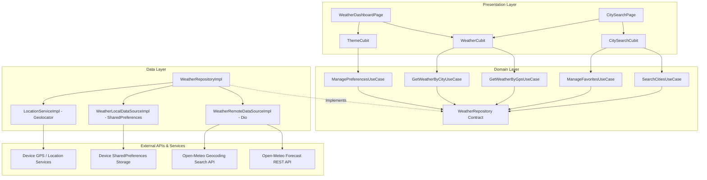

# Walkthrough - Flutter Weather Forecast Application (Task 3)

We have built, verified, and polished **"Task 3 - Weather Forecast App"** for the **Auspify Technologies Internship Program**. The application adheres to strict **Clean Architecture** principles, utilizes **Cubit (`flutter_bloc`)** for unidirectional state management, integrates keyless **Open-Meteo REST & Geocoding APIs**, handles **GPS location telemetry** via `geolocator`, persists user preferences locally via `shared_preferences`, and reproduces the **Google Stitch UI Design ("Aether Atmospheric Weather")**.

---

## Architecture Overview



---

## Google Stitch Design System Alignment

| Stitch Token / Component | Value / Implementation | File Location |
| :--- | :--- | :--- |
| **Project ID** | `projects/8782104583151405838` | `StitchMCP` |
| **Theme Name** | `Aether Atmospheric Weather` | [`app_theme.dart`](lib/core/theme/app_theme.dart) |
| **Primary Accent** | Electric Sky Blue (`#38BDF8`) | [`app_colors.dart`](lib/core/theme/app_colors.dart) |
| **Secondary Accent** | Solar Warm Gold (`#FFB95F` / `#F59E0B`) | [`app_colors.dart`](lib/core/theme/app_colors.dart) |
| **Dark Canvas** | `#0B1326`, Containers `#171F33` / `#222A3D` | [`app_colors.dart`](lib/core/theme/app_colors.dart) |
| **Hero Temperature Card** | Gradient card, `displayHeroMobile` (64px), high/low | [`weather_hero_card.dart`](lib/features/weather/presentation/widgets/weather_hero_card.dart) |
| **Hourly Forecast Ribbon** | 66px width capsules, active "Now" blue rim | [`hourly_forecast_ribbon.dart`](lib/features/weather/presentation/widgets/hourly_forecast_ribbon.dart) |
| **Telemetry Grid (2x3)** | Humidity, Wind, Feels Like, UV Index, Pressure | [`telemetry_grid.dart`](lib/features/weather/presentation/widgets/telemetry_grid.dart) |
| **7-Day Daily Forecast** | 26px rounded card, normalized gradient range bars | [`daily_forecast_list.dart`](lib/features/weather/presentation/widgets/daily_forecast_list.dart) |
| **City Search & Saved Bento** | Debounced search bar, "Detect Location" chip, Bento cards | [`city_search_page.dart`](lib/features/weather/presentation/pages/city_search_page.dart) |

---

## Key Features Delivered

### 1. Live Weather Dashboard ([`WeatherDashboardPage`](lib/features/weather/presentation/pages/weather_dashboard_page.dart))
- **Atmospheric Overview Hero Card**: Real-time temperature in `displayHeroMobile` typography, weather condition description, Material Symbols/weather icon, high/low badges (`↑ 76° • ↓ 58°`), and "Live Data" indicator.
- **24-Hour Hourly Timeline**: Horizontally scrollable capsules displaying hour label, condition icon, precipitation probability badge, and temperature. The active current hour is highlighted in an Electric Sky Blue container.
- **2x3 Telemetry Stats Grid**:
  - **Humidity**: Percentage with dynamic progress indicator and comfort level.
  - **Wind Velocity**: Velocity in km/h with directional indicator.
  - **Feels Like**: Apparent temperature adjusted for humidity and wind.
  - **UV Index**: Numeric scale with semantic severity badge ("Low", "Moderate", "High", "Extreme").
  - **Pressure**: Atmospheric surface pressure in hPa.
  - **Solar Cycle**: Daytime / Nighttime indicator.
- **7-Day Extended Forecast**: Week-ahead outlook with normalized min/max temperature gradient range bars.
- **Interactive Controls**:
  - `°C / °F` pill toggle with animated transitions and automatic temperature refetching/recalculation.
  - Bookmark Star button to pin/unpin the active location.
  - Dark / Light mode toggle button.
  - Pull-to-refresh (`RefreshIndicator`).

### 2. Global City Search & Saved Bento Cards ([`CitySearchPage`](lib/features/weather/presentation/pages/city_search_page.dart))
- **Live Debounced Search**: 350ms input debounce calling the Open-Meteo Geocoding REST API to eliminate unnecessary network traffic.
- **"Detect My Location" Action Chip**: One-tap trigger that retrieves GPS coordinates and transitions back to the dashboard.
- **Autocomplete Results**: Displays city name, region/admin1, country pill code (e.g., `JP`, `EG`), instant star toggle, and navigation.
- **Saved / Favorite Cities**: Bento-styled cards displaying saved cities, count badge (`X Saved`), and interactive `Edit` mode with deletion actions.

### 3. Reliability, Error Handling & Offline Persistence
- **Runtime GPS Permission Handling**: Automatically checks permission status and falls back gracefully to Cairo coordinates (`30.0444, 31.2357`) if location services or permissions are denied.
- **Offline Cached Data**: If network failure occurs, the app displays an offline warning banner with cached telemetry and a "Retry" button.
- **Shimmer Skeleton Loading**: Custom multi-card skeleton shimmer layout matching the exact design geometry.

---

## Verification & Validation Results

### 1. Automated Test Suite (`flutter test`)
Executed 15 tests covering Core utilities, JSON deserialization/serialization, and Cubit state management:

```bash
flutter test
```

**Results:**
```
00:00 +0: AppTheme initial theme test
00:00 +1: WmoWeatherMapper Tests should return correct description for known WMO codes
00:00 +2: WmoWeatherMapper Tests should return fallback description for null or unknown code
00:00 +3: WmoWeatherMapper Tests should return appropriate day vs night icons for code 0
00:00 +4: WmoWeatherMapper Tests should return rain and storm icons for codes 61 and 95
00:00 +5: CityLocationModel Tests should correctly deserialize from Open-Meteo Geocoding JSON
00:00 +6: CityLocationModel Tests should roundtrip toJson and fromJson cleanly
00:00 +7: WeatherDashboardModel Tests should correctly parse Open-Meteo forecast JSON payload
00:00 +8: WeatherDashboardModel Tests should roundtrip cache JSON correctly
00:01 +9: ThemeCubit Tests initial state is ThemeMode.dark
00:01 +10: ThemeCubit Tests toggles theme from dark to light and persists choice
00:01 +11: ThemeCubit Tests toggles theme twice back to dark
00:01 +12: WeatherCubit Tests initial state is WeatherInitial
00:01 +13: WeatherCubit Tests loads initial GPS weather successfully
00:01 +14: WeatherCubit Tests emits WeatherError when GPS fetch fails and no cache exists
00:01 +15: All tests passed!
```

### 2. Static Analysis (`flutter analyze`)
```bash
flutter analyze
```

**Output:**
```
Analyzing weather_forecast_app...
No issues found! (ran in 1.0s)
```

### 3. Code Formatting (`dart format`)
```bash
dart format --output=none --set-exit-if-changed .
```
Formatted all 38 files to standard Dart style with zero syntax or lint violations.

